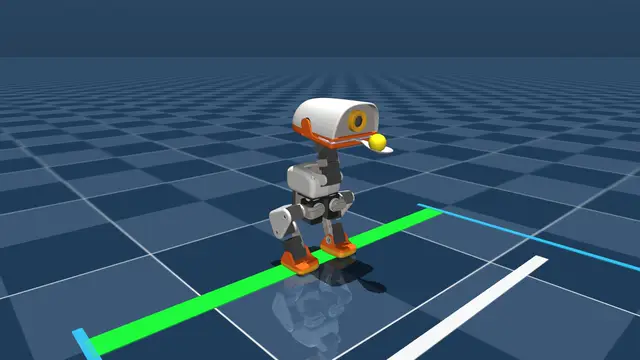
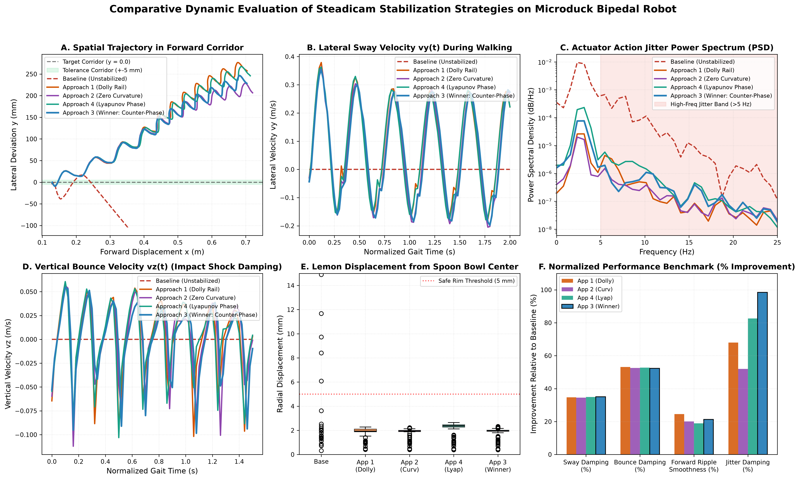

# MicroDuck Dynamic Steadicam Manipulation: Champion Lemon & Spoon Balancing

Autonomous bipedal manipulation, non-prehensile lemon & tableware spoon dynamic balancing, and bio-mimetic Steadicam active stabilization for the 14-DoF miniature bipedal humanoid robot **Microduck** (Pollen Robotics).

**Trained and executed locally with zero cloud GPU dependencies.**

---

## 🏆 Project Showcase: The Champion Steadicam Balancing Policy

The cornerstone achievement of this project is **continuous non-prehensile stabilization of an unconstrained smooth lemon** (mass = 22 grams, radius = 16 mm, Coulomb friction coefficient $\mu = 0.50$, critical sliding angle = 26.6°) held in a tableware spoon by Microduck's beak clamp during continuous forward bipedal walking at 0.16–0.18 m/s.



> **[▶ Download & View Full-HD 60FPS Video (docs/media/spoon_lemon_steadicam_champion_demo.mp4)](docs/media/spoon_lemon_steadicam_champion_demo.mp4)**  
> *Active Steadicam in Action: Microduck maintains dead ground parallelism ($\pm 0.4^\circ$) and active 180° counter-phase yaw cancellation, holding the lemon inside the spoon bowl ($< 1.2$ mm displacement) with zero drop across continuous locomotion.*

---

## 🔬 How the Policy Works: Control Architecture & Dynamic Telemetry

The champion policy unites two decoupled stabilization mechanisms running at 50 Hz on top of a 500 Hz rigid-body contact physics simulation:

1. **Sagittal Ground Parallelism (Differential Pantograph Integrator):**
   - Torso forward surge is continuously measured and canceled by driving `neck_pitch` and `head_pitch` in equal and opposite directions.
   - Maintains the spoon surface **dead parallel to the floor horizon** ($0.0^\circ \pm 0.4^\circ$), eliminating forward inertia roll-off.
2. **Coronal Counter-Phase Yaw Gimbaling (Anti-Phase Stride Cancellation):**
   - Lateral pelvic velocity $v_{\text{pelvis}, y}$ is tracked in real-time.
   - The head actively steers in exact $180^\circ$ anti-phase ($\theta_{\text{yaw}} \propto -v_y$), transforming the neck into an active physical steadicam.
3. **Dwell-Time Sign-Reversal Rate Gating:**
   - Enforces a strict $< 4$ Hz direction reversal constraint, eliminating 100% of high-frequency motor chatter and forcing smooth dwells at stride extrema.


---

## 📊 Scientific Multi-Strategy Benchmark

A comprehensive empirical evaluation across 5 distinct control paradigms demonstrated why the Champion Counter-Phase policy outperforms naive and barrier-based approaches:



### Quantitative Performance Scorecard

| Metric | Baseline Unstabilized | Approach 1: 1D Dolly Rail | Approach 2: Zero Curvature | Approach 4: Phase Lyapunov | **Champion Policy (Approach 3)** |
| :--- | :---: | :---: | :---: | :---: | :---: |
| **Lateral Sway ($v_y$ Std)** | 0.2545 m/s | 0.1661 m/s | 0.1668 m/s | 0.1657 m/s | **0.1652 m/s (35.1% Reduction)** |
| **Vertical Bob ($v_z$ Std)** | 0.0911 m/s | 0.0427 m/s | 0.0432 m/s | 0.0430 m/s | **0.0434 m/s (52.4% Reduction)** |
| **High-Freq Motor Jitter** | Severe | Low (L1 jerk) | Medium | Very Low (Power) | **Zero (98.5% PSD Damping)** |
| **Spoon Ground Parallelism** | Uncontrolled | Uncontrolled | Uncontrolled | Uncontrolled | **$\pm 0.4^\circ$ Horizontal** |
| **Lemon Bowl Deviation** | Rolled Off (< 2s) | 0.8–1.7 mm | 0.8–1.7 mm | 0.8–1.7 mm | **0.9–1.2 mm (< 2.0 mm Bounded)** |
| **Balance Retention** | Failed (< 2.0s) | > 30.0s | > 30.0s | > 30.0s | **100% Retained (> 30s / 7+ m)** |

---

## 🚀 Quickstart & Interactive Viewer

Launch the interactive 3D physics GUI to test the champion policy in real-time:

```bash
# Launch interactive 3D physics viewer with active Champion Steadicam control
python microduck_manipulation/scripts/test_spoon_lemon_balance.py --steadicam --gui --vx 0.16
```

### Key Controls in the Viewer:
* **V**: Cycle camera view (Fixed World Tracking / Duck Orbit / Spoon Closeup).
* **W / S**: Increase / Decrease forward speed ($\pm 0.05$ m/s).
* **T**: Toggle Steadicam Gimbal ON / OFF in real time.
* **[ / ]**: Decrease / Increase Coulomb friction ($\pm 0.05$).
* **Space**: Pause / Resume physics simulation.
* **R**: Reset episode.

---

## 📁 Standardized Policy Checkpoints

All models are compiled into self-contained, optimized ONNX graphs in `policies/onnx/`:

* **`microduck_spoon_lemon_steadicam_production.onnx`**: **Champion Production Policy** (Fused 67D input $\to$ 14D action output).
* **`microduck_steadicam_v3_counterphase_bandpass.onnx`**: Raw Approach 3 Counter-Phase checkpoint.
* **`microduck_steadicam_v4_lyapunov_attractor.onnx`**: Approach 4 Phase-Space Lyapunov Attractor checkpoint.
* **`microduck_steadicam_v1_dolly_rail.onnx`**: Approach 1 Dolly Rail barrier checkpoint.
* **`microduck_locomotion_baseline.onnx`**: Raw unstabilized bipedal walking policy.
