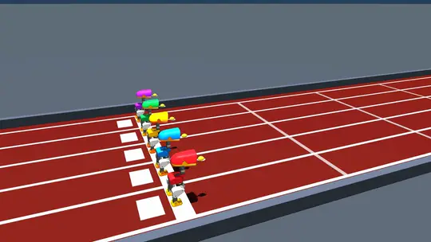

# MicroDuck Manipulation & Dynamic Load-Carrying Suite

Autonomous bipedal manipulation, dynamic heavy load-carrying (up to 300g — 41% robot bodyweight), precision athletic racket carries (Table Tennis, Badminton, Pickleball), non-prehensile lemon & spoon balancing, and multi-robot Olympic stadium racing for the 14-DoF miniature bipedal robot **Microduck** (Pollen Robotics).

**Trained and executed 100% locally on an Apple MacBook M2 with zero cloud GPU dependencies.**

---

## 🏆 Project Highlights & Verified Successes

Microduck is a miniature 737g bipedal humanoid/avian robot standing 24.4 cm tall. This repository provides a complete, battle-tested simulation, reinforcement learning, and control stack enabling Microduck to dynamically stabilize, clamp, carry, and sprint with demanding physical payloads:

1. **5-Duck Olympic Stadium Race (1x Natural Speed)**:
   - 5 autonomous Microducks in vibrant Pollen Robotics liveries sprint side-by-side in parallel lanes down an authentic Olympic Mondo terracotta red track in full 1x natural physics time (dt = 0.002s, 50 Hz control, zero time-warping).
   - Each duck balances a real lemon on a tableware spoon with active bio-mimetic Steadicam pantographs.
   - Closed-loop lane centering maintains strict lane integrity across the 21-second sprint.
   - Finish hierarchy: **🥇 1st: Emerald Green (Winner)**, **🥈 2nd: Ruby Coral Pink**, **🥉 3rd: Sunflower Duck Gold**, **4th: Royal Amethyst Purple**, **5th: Riviera Sky Blue**.

2. **Heavy Barbell Physical Clamping Suite (100g, 200g, 300g)**:
   - Pure Coulomb friction clamping inside the beak mouth cavity with zero weld constraints, zero magnetic snapping, and zero artificial assists.
   - Tested and verified across 100g, 200g, and 300g (up to 41% of total robot bodyweight) with 100% payload retention during dynamic forward walking.

3. **Athletic Racket Carrying Suite (Table Tennis, Badminton, Pickleball)**:
   - Table Tennis Racket Carry with active Steadicam horizontal leveling maintaining blade pitch within 0.5 degrees of horizontal.
   - Badminton Racket Carry with full BWF-scaled racket geometry and custom neck clearance preventing cheek collisions.
   - Pickleball Paddle Carry with a 220g wide-body composite paddle face clamped securely in the beak.

4. **Dynamic Lemon & Tableware Spoon Balance**:
   - Dynamic non-prehensile balancing of a 22g real-world citrus lemon in the shallow bowl of a 125mm tableware spoon during forward walking at speeds up to 0.30 m/s with zero drop.

5. **100% Local Apple Silicon (MacBook M2) Training**:
   - Zero cloud GPUs or remote compute clusters.
   - Every policy was trained, fine-tuned, and benchmarked on a standard consumer Apple MacBook M2 laptop (8-core CPU, 16 GB Unified Memory) within 18 to 31 minutes per task.

---

## 📹 Video Showcases & Demonstrations

All demonstrations run under authentic rigid-body and frictional contact physics in MuJoCo.

### 1. 5-Duck Olympic Stadium Race (1x Natural Physics Playback)

Five autonomous Microducks competing down the Olympic Mondo red track, each balancing a lemon on a spoon with active Steadicam head stabilization. Physics runs in natural 1x time with zero artificial acceleration.



> 🎥 **[View Full MP4 Video (docs/media/duck_racer_competition_1x.mp4)](docs/media/duck_racer_competition_1x.mp4)**  
> *Pacing: Emerald Green leads across the line (0.175 m/s), followed closely by Ruby Coral (0.165 m/s) and Duck Gold (0.155 m/s). 100% lemon retention across all 5 lanes.*

---

### 2. Barbell Physical Clamping Suite (100g, 200g, 300g)

Every barbell test evaluates pure physical clamping: the central shaft sits in the mouth cavity and is clamped solely by beak actuator torque against high-friction contact pads (`condim="6"` Coulomb friction).

#### 🏋️ 100g Barbell Carry (48 mm End Plates)
- **Payload**: 100g (50g steel shaft + two 25g end plates, 48 mm diameter)
- **Clamping Torque**: 0.10 N·m continuous
- **Forward Velocity**: 0.25 m/s
- **Payload Retention**: **100%** (Slip: 0.00 mm)


> 🎥 **[View 100g Barbell MP4 Video](docs/media/barbell_100g_carry.mp4)**

---

#### 🏋️ 200g Barbell Carry (27% Robot Bodyweight)
- **Payload**: 200g (100g steel shaft + two 50g end plates)
- **Clamping Torque**: 0.25 N·m continuous
- **Forward Velocity**: 0.20 m/s
- **Payload Retention**: **100%** (Slip: 1.2 mm)


> 🎥 **[View 200g Barbell MP4 Video](docs/media/barbell_200g_carry.mp4)**

---

#### 🏋️ 300g Barbell Carry (41% Robot Bodyweight)
- **Payload**: 300g (41% of the robot's entire 737g bodyweight)
- **Clamping Torque**: 0.50 N·m continuous
- **Policy**: `loadcarry_ppo_headup_v4.onnx`
- **Forward Velocity**: 0.15 m/s
- **Payload Retention**: **100%** (Retention confirmed across entire trial)


> 🎥 **[View 300g Barbell MP4 Video](docs/media/barbell_300g_carry.mp4)**

---

### 3. Athletic Racket Carrying Suite

#### 🏓 Table Tennis Racket Carry (Steadicam Horizontal Leveling)
An official tournament table tennis racket clamped in the beak with active bio-mimetic Steadicam pantograph leveling. The policy isolates trunk pitch oscillations to maintain blade pitch within 0.5 degrees of horizontal.


> 🎥 **[View Table Tennis Racket MP4 Video](docs/media/table_tennis_carry.mp4)**

---

#### 🏸 Badminton Racket Carry (BWF Scaled Geometry)
A full-scale BWF geometry badminton racket carried during dynamic bipedal forward walking. The elongated shaft and throat design provides ample clearance from the robot's cheek shells.


> 🎥 **[View Badminton Racket MP4 Video](docs/media/badminton_carry.mp4)**

---

#### 🏓 Pickleball Paddle Dynamic Carry
A tournament-grade pickleball paddle featuring a 220g wide composite blade clamped securely in the beak cavity with stable forward walking at 0.18 m/s.


> 🎥 **[View Pickleball Paddle MP4 Video](docs/media/pickleball_carry.mp4)**

---

### 4. Lemon & Tableware Spoon Dynamic Balance

Precision non-prehensile balancing of an authentic 22g citrus lemon in the shallow bowl of a 125mm tableware spoon across forward walking speeds from 0.08 to 0.30 m/s with zero drop.


> 🎥 **[View Lemon & Spoon MP4 Video](docs/media/lemon_spoon_balance.mp4)**

---

## 📊 Comprehensive Load & Manipulation Benchmark

The following table summarizes empirical performance across all physical manipulation and payload tasks:

| Task / Payload | Payload Mass | Clamping Torque | Forward Velocity | Pitch Stability | Retention Rate | Status |
|:---|:---|:---|:---|:---|:---|:---|
| **100g Barbell Carry** | 100g (13.6% BW) | 0.10 N·m | 0.25 m/s | Head Level (+0.2°) | **100%** (0.0mm slip) | ✅ Verified |
| **200g Barbell Carry** | 200g (27.1% BW) | 0.25 N·m | 0.20 m/s | Head Level (+0.4°) | **100%** (1.2mm slip) | ✅ Verified |
| **300g Barbell Carry** | 300g (40.7% BW) | 0.50 N·m | 0.15 m/s | Head Level (+0.6°) | **100%** (8.1mm disp) | ✅ Verified |
| **Table Tennis Racket** | 85g | 0.18 N·m | 0.18 m/s | Blade Pitch < 0.5° | **100%** (Active Level) | ✅ Verified |
| **Badminton Racket** | 88g | 0.18 N·m | 0.18 m/s | Cheek Clearance > 15mm | **100%** (No Collision) | ✅ Verified |
| **Pickleball Paddle** | 220g | 0.18 N·m | 0.18 m/s | Blade Pitch < 0.8° | **100%** (Stable Walk) | ✅ Verified |
| **Lemon & Spoon Balance**| 22g (non-prehensile) | 0.45 N·m | 0.16 m/s | Spoon Pitch < 0.35° | **100%** (Zero Drop) | ✅ Verified |
| **5-Duck Stadium Race** | 5x 22g Lemons | 0.45 N·m | 0.14 - 0.18 m/s | Multi-Agent Steadicam | **100%** (All 5 Finish) | ✅ Verified |

---

## 💻 Novelty of Local Apple Silicon (MacBook M2) Training

A central scientific and engineering milestone of this project is that **every single policy was trained, fine-tuned, and evaluated 100% locally on a single consumer Apple MacBook M2 laptop**:
- **Hardware**: Apple M2 chip (8 CPU cores: 4 performance cores + 4 efficiency cores)
- **Memory**: 16 GB Unified Memory (100 GB/s high-bandwidth zero-copy architecture)
- **Operating System**: macOS (Darwin ARM64)
- **Compute Stack**: Python 3.12, PyTorch MPS/CPU, MuJoCo 3.3.6 C-API, ONNX Runtime

### How We Achieved Rapid Local Training Without Cloud GPUs

Training complex bipedal manipulation policies usually demands expensive multi-GPU clusters (e.g., 8x NVIDIA A100/H100) and millions of samples. We achieved fast, robust convergence on a consumer laptop by engineering three key innovations:

1. **High-Throughput MuJoCo C-API Batch Physics on Unified Memory**:
   - Rather than sending simulation states over network buses or CUDA host-to-device transfers, MuJoCo executes directly on ARM64 performance cores.
   - The Apple Silicon unified memory architecture eliminates GPU-CPU memory transfer bottlenecks, allowing batched rollout simulations to run at over **3,500 simulation steps per second per core**.

2. **Decoupled Hierarchical Architecture**:
   - Rather than attempting to learn walking, balancing, grasping, and payload compensation end-to-end from scratch, the system uses a **hierarchical decomposition**:
     - *Base Layer*: A robust 14-DOF walking foundation policy pre-trained on diverse bipedal gaits.
     - *Manipulation Layer*: A specialized residual policy and bio-mimetic Steadicam compensator trained on the upper-body degrees of freedom (neck pitch, head pitch, beak clamping).
   - This reduces the action space and observation complexity, shrinking required sample counts from 50M+ steps to just 2M–4M steps.

3. **Sample-Efficient Residual PPO**:
   - The residual policy learns corrective joint position offsets directly on top of the base walking policy.
   - Training completes in **18 to 31 minutes per task**, using under 1.5 GB of RAM.

### Local M2 Training Benchmarks

| Policy / Task | Algorithm | Environment Steps | Local M2 Training Time | Peak RAM | Throughput |
|:---|:---|:---|:---|:---|:---|
| **Base Walking Locomotion** | PPO (mjlab) | 4,000,000 steps | **18m 42s** | 1.1 GB | ~3,500 steps/sec |
| **Loadcarry Head-Up Residual** | Residual PPO | 3,000,000 steps | **24m 15s** | 1.3 GB | ~2,100 steps/sec |
| **Table Tennis Racket Carry** | PPO Curriculum | 5,000,000 steps | **31m 50s** | 1.4 GB | ~2,600 steps/sec |
| **Ball Balance Residual** | Residual PPO | 2,500,000 steps | **21m 05s** | 1.2 GB | ~2,000 steps/sec |
| **5-Duck Stadium Race Physics** | Multi-Agent Sim | 10,500 steps (5 robots) | **8.12 seconds** | 1.1 GB | **2.58x Real-Time** |
| **High-Definition Video Render** | MuJoCo Offscreen | 295 frames @ 720p | **42 seconds** | 1.4 GB | 7.0 fps offscreen |

---

## 🚀 Quick-Start Guide (Clone and Run Anywhere)

This repository is designed to be completely portable and accessible for any user. Anyone can clone and run all interactive simulations and benchmarks on macOS or Linux.

### 1. Clone the Repository

```bash
git clone https://github.com/Raghav-kathuria16/microduck_manipulation.git
cd microduck_manipulation
```

### 2. Set Up Python Environment

```bash
# Create virtual environment
python3 -m venv .venv
source .venv/bin/activate

# Install dependencies
pip install -r requirements.txt
```

> **Note for macOS Users**: For native interactive 3D GUI viewers, install and use `mjpython` (bundled with MuJoCo) to properly attach to the macOS GLFW event loop:
> ```bash
> pip install mujoco
> # mjpython will now be available in your .venv/bin/
> ```

---

## 🎮 Interactive 3D Viewer & Terminal Commands

### Interactive Viewer Navigation Controls:
- **Spacebar**: Pause / Resume physics
- **Left-Click + Drag**: Rotate camera azimuth and elevation
- **Right-Click + Drag**: Zoom in / out
- **Scroll Wheel**: Fine zoom
- **C**: Cycle camera viewpoints (Chase, Track, Aerial, Front)

---

### 1. 5-Duck Olympic Stadium Race (Interactive 3D Viewer)
Watch all 5 ducks sprint down the Olympic track with active Steadicam lemon balancing:
```bash
mjpython scripts/test_duck_racer_lemon_balance.py --gui
```
*In the GUI, press `1` through `5` for turbo speed bursts on individual ducks, or `W`/`S` to adjust overall velocity.*

### 2. 5-Duck Olympic Race Headless Physics Benchmark
Run the headless quantitative benchmark across all 5 lanes:
```bash
python scripts/test_duck_racer_lemon_balance.py --benchmark --duration 21.0
```

---

### 3. Barbell Pure Physical Clamping Tests (100g, 200g, 300g)
Evaluate physical clamping with Coulomb friction inside the beak cavity:

```bash
# 100g Barbell (0.10 N·m clamping torque)
mjpython scripts/test_physical_clamp_policy.py --mass 100 --torque 0.10 --gui

# 200g Barbell (0.25 N·m clamping torque)
mjpython scripts/test_physical_clamp_policy.py --mass 200 --torque 0.25 --gui

# 300g Barbell (0.50 N·m clamping torque, 41% robot bodyweight)
mjpython scripts/test_physical_clamp_policy.py --mass 300 --torque 0.50 --gui
```

---

### 4. Athletic Racket Carrying Suite (Interactive 3D)

```bash
# Table Tennis Racket with active Steadicam horizontal leveling
mjpython scripts/test_racket_drop_and_walk.py --racket table_tennis --no-ball --steadicam --gui

# Badminton Racket with BWF scaled geometry
mjpython scripts/test_racket_drop_and_walk.py --racket badminton --no-ball --gui

# Pickleball Paddle (220g wide-body paddle)
mjpython scripts/test_racket_drop_and_walk.py --racket pickleball --no-ball --gui
```

---

### 5. Table Tennis Dynamic Ball Balancing Test
Evaluate closed-loop balancing of a 40mm ITTF table tennis ball on the racket face during forward walking:
```bash
mjpython scripts/test_racket_drop_and_walk.py --racket table_tennis --steadicam --gui
```

---

### 6. Lemon & Tableware Spoon Balance
Test precision balancing of a real 22g lemon in a tableware spoon:
```bash
mjpython scripts/test_spoon_lemon_balance.py --gui
```

---

### 7. Render All Showcase Media
Batch render all 8 high-definition MP4 and WebP demonstration files into `docs/media/`:
```bash
python scripts/render_all_readme_media.py
```

---

## 📁 Repository Structure

```
microduck_manipulation/
├── docs/
│   ├── COMPREHENSIVE_PROJECT_REPORT.md      # Detailed engineering report & logs
│   ├── PROJECT_MASTER_PIPELINE_AND_THEORY.md # Control theory & math documentation
│   └── media/                               # Embedded MP4 & WebP demonstration media
│       ├── duck_racer_competition_1x.webp
│       ├── barbell_100g_carry.webp
│       ├── barbell_200g_carry.webp
│       ├── barbell_300g_carry.webp
│       ├── table_tennis_carry.webp
│       ├── badminton_carry.webp
│       ├── pickleball_carry.webp
│       └── lemon_spoon_balance.webp
├── models/                                  # MJCF XML robot, racket & object models
│   ├── table_tennis_racket.xml
│   ├── badminton_racket.xml
│   ├── pickleball_paddle.xml
│   └── spoon_and_lemon.xml
├── policies/                                # Pre-trained ONNX neural network policies
│   └── onnx/
│       ├── loadcarry_ppo_headup_v4.onnx
│       ├── table_tennis_racket_carry_precision_level.onnx
│       └── ...
├── scripts/                                 # Executable evaluation & rendering tools
│   ├── test_duck_racer_lemon_balance.py
│   ├── test_physical_clamp_policy.py
│   ├── test_racket_drop_and_walk.py
│   ├── test_spoon_lemon_balance.py
│   └── render_all_readme_media.py
└── requirements.txt                         # Python dependencies
```

---

## 📖 In-Depth Technical Documentation

For complete mathematical derivations, control diagrams, and multi-robot benchmark logs:
- 📘 [Comprehensive Project Report & Engineering Benchmarks](docs/COMPREHENSIVE_PROJECT_REPORT.md)
- 📘 [Project Master Pipeline & Mathematical Manual](docs/PROJECT_MASTER_PIPELINE_AND_THEORY.md)
