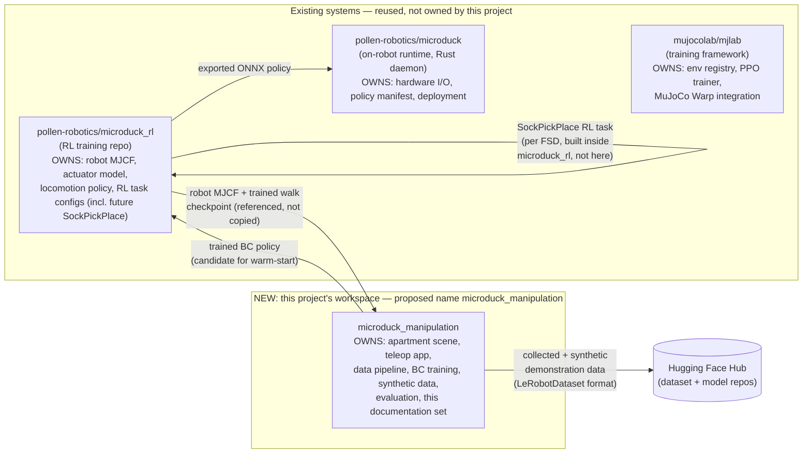
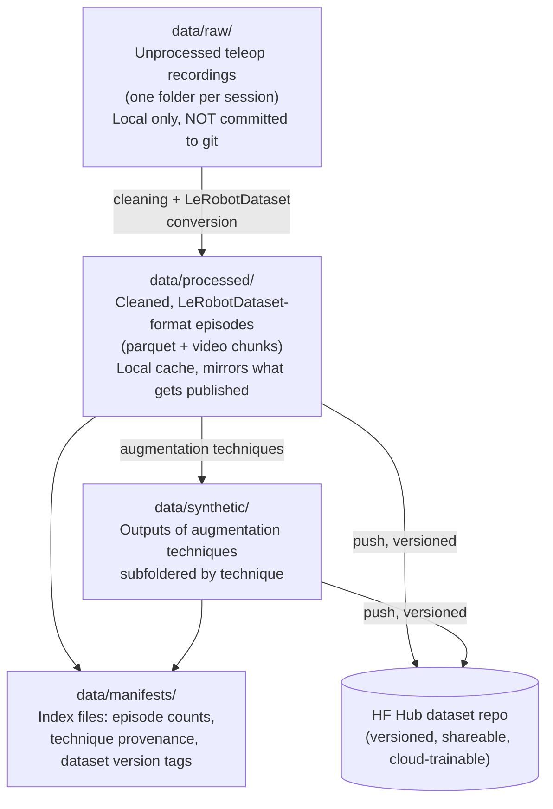

# Microduck Sock Pick-and-Place — Workspace & Repository Architecture

This document describes **where everything lives and how it's managed** —
not how anything is implemented. No code. It's written so a new person
joining the project (not just an AI) can orient themselves: what exists,
what's about to exist, where it's stored, and who/what touches it.

It assumes the two prior documents already exist as project references:
- The **FSD** (`microduck_sock_pickplace_fsd.md`) — the pure-RL task spec.
- The **Teleop/Data/Policy Spec** (`microduck_teleop_data_policy_spec.md`)
  — the data-first BC-then-RL strategy this architecture supports.

This document does not repeat their content — it repeats only what's needed
to explain *where things go*.

---

## PART 1 — System Boundaries: What Owns What

There are four systems in play. Three already exist and are **not modified**
by this project except where explicitly noted. One is new — this project's
own workspace.



### Naming note
`microduck_manipulation` is the name for this repo/workspace. Everything
below assumes this repo exists as its own git repository, separate from
`microduck_rl`.

### Why a separate repo
The two projects have different release cadences, different dependency stacks
(this one needs teleop/GUI/BC libraries; `microduck_rl` needs MuJoCo
Warp/PPO), and different primary users. Keeping them separate avoids
polluting `microduck_rl`'s history and dependency footprint with unrelated
teleop-app churn, while the two-arrow relationship above (MJCF/checkpoint
in, trained BC policy out) keeps them connected without merging them.

---

## PART 2 — Top-Level Workspace Layout

```
microduck_manipulation/
├── scenes/                 # MuJoCo apartment scene definitions
│   └── apartment_v1/       # v1 scene (geometry, textures, assets)
├── teleop/                 # Hierarchical teleop app (reserved)
├── data/
│   ├── raw/                # Unprocessed teleop recordings (git-ignored)
│   ├── processed/          # LeRobotDataset-format episodes (git-ignored)
│   ├── synthetic/          # Augmented data by technique (git-ignored)
│   │   ├── re_sim/
│   │   ├── mirrored/
│   │   ├── scripted/
│   │   ├── time_warped/
│   │   ├── state_noise/
│   │   ├── visual_dr/
│   │   ├── procedural_variants/
│   │   └── dagger/
│   └── manifests/          # Lightweight indexes (git-tracked)
├── policies/
│   ├── bc/                 # BC model configs & checkpoints
│   │   ├── act/
│   │   ├── diffusion_policy/
│   │   └── smolvla/
│   ├── rl_reference/       # Pointer to microduck_rl walk checkpoint
│   └── exported/           # Handoff shelf for cross-repo artifacts
├── configs/                # Parametrized configs (scene, teleop, cameras, logging)
├── docs/                   # Project documentation set
├── scripts/                # Operational entry points (reserved)
├── external/               # Dependency version pins
├── .env.example
├── .gitignore
├── README.md
└── CHANGELOG.md
```

---

## PART 3 — `scenes/` and `configs/`

### `scenes/`
Holds the apartment scene(s) described in the Teleop/Data spec Part 2.
As procedural apartment variants come online, this folder holds **one
subfolder per variant**, not one monolithic scene file.

### `configs/`
Everything parametrized rather than fixed:
- `scene_apartment_v1.yaml` — spawn zones, target positions, lighting presets
- `teleop_controls.yaml` — input-to-command mapping for the four control layers
- `cameras.yaml` — camera rig definitions (top-down, chase, beak-cam)
- `task_instructions.yaml` — natural-language labels for episodes
- `data_logging.yaml` — per-timestep and per-episode logging schema

**Why split from `scenes/`:** scene geometry changes rarely; configs change
constantly. Separating them keeps diffs small and reviewable.

---

## PART 4 — `data/`: The Data Architecture

### Layering



### Folder-by-folder

- **`data/raw/`** — what the teleop session recorded before cleaning. One
  subfolder per session, timestamped. Bulky, stays local, git-ignored.
- **`data/processed/`** — training-ready LeRobotDataset-format episodes.
  Local cache of what's published to the Hub.
- **`data/synthetic/`** — same format as processed, subfoldered by
  augmentation technique for traceability.
- **`data/manifests/`** — small, git-tracked index/summary files.

### Long-term storage
The **Hugging Face Hub dataset repo** is the canonical, versioned home for
anything meant to persist or be used for cloud training.

---

## PART 5 — `policies/`: Model & Checkpoint Architecture

- **`policies/bc/`** — BC model configs and checkpoints, sub-organized by
  architecture (ACT, Diffusion Policy, SmolVLA) and training location.
- **`policies/rl_reference/`** — NOT a place RL policies are trained. Holds
  only a reference pointer to which `microduck_rl` checkpoint this project's
  teleop layer depends on.
- **`policies/exported/`** — staging area for artifacts crossing into
  `microduck_rl`'s or the daemon's world.

### Naming convention
`{task}_{method}_{variant}_{date}` — e.g.,
`sockpickplace_act_batch03_20260909`. Task, method, data-batch lineage, and
date should all be recoverable from the name alone.

---

## PART 6 — `scripts/` and `teleop/`

Currently reserved. Intended contents once implementation starts:

- **`teleop/`** — the hierarchical control app (input handling, command
  layers, GUI with camera views).
- **`scripts/`** — operational entry points: recording sessions, raw→processed
  conversion, augmentation techniques, local BC training, Hub publishing.

---

## PART 7 — `external/`: Dependency Referencing

Holds **pointers, not copies**: `microduck_rl_pin.json` documents the exact
version (repo URL + commit hash or tag) of `microduck_rl` this workspace
was built against. When `microduck_rl` changes (e.g., beak DOF added per
FSD M0), bump the pin deliberately as a visible, reviewable change.

---

## PART 8 — Environment & Compute Management

| Environment | Where | What it's for | NOT for |
|---|---|---|---|
| **Local dev** | MacBook M2 | Scene authoring, teleop, data cleaning, small BC prototyping | RL training, VLA-scale training |
| **Cloud** | HF Jobs / Colab | RL training, VLA-scale BC, large-batch synthetic data | Interactive teleoperation |

**Two separate dependency manifests** — local needs teleop/GUI/CPU libs,
cloud needs CUDA packages. Don't merge them.

---

## PART 9 — Version Control & Change Management

- **Committed:** scenes, configs, docs, `data/manifests/`, `external/` pin, code.
- **Git-ignored:** `data/raw/`, `data/processed/`, `data/synthetic/`, model weights.
- **Dataset/model versioning:** on HF Hub (commits/tags), not in git.
- **CHANGELOG.md:** append-only reasoning log capturing *why*, not just *what*.

---

## PART 10 — Documentation Set & Handoff Path

Read order for new people:
1. **This document** — orientation.
2. **Teleop/Data/Policy Spec** — what to build first and why.
3. **The FSD** — longer-horizon RL task spec.
4. **CHANGELOG.md** — accumulated reasoning.

### Minimal onboarding checklist
- Read the three documents above, in order.
- Get HF Hub token → `.env`.
- Confirm `external/microduck_rl_pin.json` matches what's installed.
- Check `data/manifests/` for current dataset status.
- Check `CHANGELOG.md` recent entries before making design changes.
